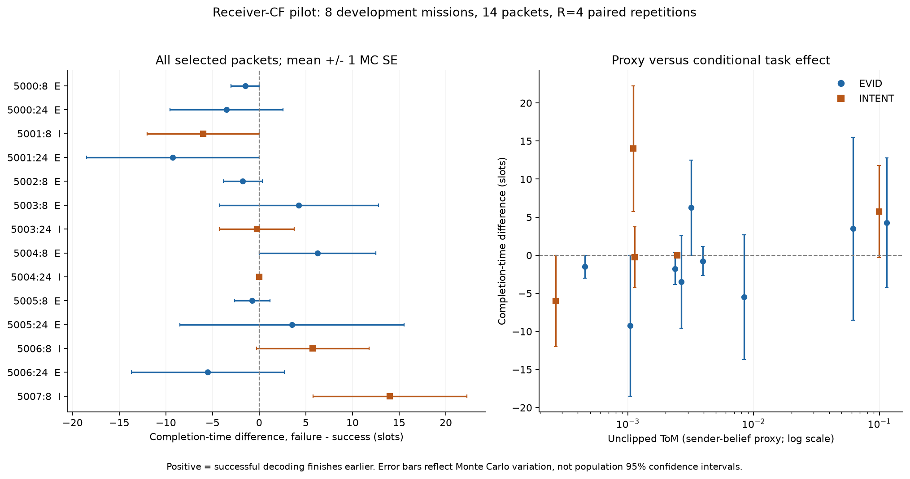

# Research Task Report

- **Research Question / Hypothesis**：[HYPOTHESIS] 固定原生可行E/I发送尝试的解码成功/失败，是否改变receiver实际下一次目标和未来任务？ToM能否排序该条件效果？本轮已完成用户批准的执行器、契约检查及有界pilot；**尚未发现足以确证的稳定、可修复性能缺陷，也未证明ToM排序失效。**
- **已核验前人工作**：[PAPER] GOSC p9 §V-D已有消息反事实，BANDMAS p3–4已有离线replay与廉价估值；沿用[上一阶段证据卡](../2026-10-16-mechanism/prior_art.md)。本轮未重新查新/核验出版状态，不声称新贡献。
- **实际阅读源码**：[CODE] 原核心387b49389385b51c275dc5a22ec1672087edda1d；启动37cf326f163a25faafc6c3d439b7068e6528f990；实际运行冻结commit **48404fd5e68c2f7671845ed10ccd2868423edfbe**。核对Agent.plan、TeamModel、GOSC.build_groups/transmit、Channel.decodes、Simulation.phase_decide/phase_communicate/result；平行realistic路径保持原样且未接入本pilot。
- **本轮新增或修改**：[隔离执行器](../../../extensions/counterfactual.py)、[有界runner](../../../experiments_ext/run_receiver_cf.py)、[冻结分析器](../../../experiments_ext/analyze_receiver_cf.py)、[13项契约](../../../tests_ext/test_receiver_cf.py)；后加仅作描述的plot/review脚本、approval/执行协议/manifest/原始hash索引、逐点CSV/图/报告/日志。核心算法、原实验、原测试、原results/缓存、旧报告与Obsidian均不修改。
- **实际运行**：[RUN] `python -m pytest tests tests_ext -q`（项目.venv）；`python -m experiments_ext.run_receiver_cf --output-dir .local/reproduction/2026-10-16-cf-pilot-v1 --gate-file .local/reproduction/2026-10-16-cf-implementation-v1/gate.json`；同run-dir的analyze/plot/review。完整命令见command_ledger.json。Config()、8个开发world seeds5000–5007、t8/24、R4、2workers各1数值线程；Planner、outage、ideal DL、orthogonal、W100、max400；无LLM。
- **测试与结果**：[RUN] 新契约13通过1.32s；执行前完整 **126通过57.39s**（包含13，不相加）。8个missions完成；16个计划时隙中14点可采、2点无原生已选E/I，实际 **112 branches / 56 paired repetitions / 14 packets / 8 independent mission clusters**。没有补点。主任务条件效果+1.09375 slots，探索性95%cluster CI **[−2.50,5.265625]**。全部112条完整且任务完成，原始false declaration合计3次全部保留。详见statistics.json、per_point.csv、preanalysis_audit.json。
- **失败/负面证据**：没有运行异常或timeout；没有测试失败。5个正/1个零/8个负点标签，但R4的MC误差很大，不能把负点估计当已确证有害消息。13个非零点中12个MC SE≥均值绝对值（事后描述性精度审查）；没有足够证据开发复杂估值器。原strictR4 failed、R4-S1 inconclusive、Receiver-D1主要区间跨零保留，不改判。
- **与原 GOSC 的差异**：临时hook仅覆盖离线指定packet的decoder返回值；始终先调用原decoder，保留draw及原调度/ACK/队列/融合/后续行为；不是新online policy，也不同于作者免费完整buffer的瞬时交付实验。未来总无线成本未匹配，不能宣称策略净收益。
- **公平性与泄露检查**：online features白名单与offline结果/可信自产checkpoint分开；候选按预定SHA采样，不用decode/outcome选点；全部16个现场native tape与direct state匹配、每agent当时UL≤100，非干预packet与draw一致，分支当前UL成本一致。76项上游hash、旧Receiver-D1的23项归档与原始raw均未变；无上传/推送。开发数据已曝光，不是未见测试集。
- **成本**：pilot wall **70.756868s**；worker CPU合计 **132.96875s**；单worker lifetime peak working set最高 **39,145,472 bytes**，parent peak50,933,760 bytes（不能相加当同时峰值）。测试另57.39s；分析与图各为独立后处理。实验LLM/API calls/tokens=0，无GPU/下载/安装；助手自身tokens未计量。原生UL/DL uses按branch保存；真实wire bytes未序列化，额外ACK/CRC/PHY/sync成本not_modeled，不写实测0。
- **可否进入下一阶段**：**Go：离线诊断执行器与可追溯样本生成；Pending：标签精度/机制归因；No-Go：稳定缺陷、新估值器优越或部署收益主张。**
- **用户需要批准的下一步**：建议先对同14个固定checkpoint检验MC标签收敛，R4→32（新增replicate4–31、最多784 branches），不换world、不选新消息、不训练模型，估计约8.3min/2workers、建议wall15min硬上限。见[next_stage_plan.md](next_stage_plan.md)。这是新批次，超出本轮128上限，**尚未批准/未运行**；本轮停在报告节点。

## 任务效果与主要估值诊断

定义DeltaT=T_failure−T_success，正值为成功解码更早完成。先平均每点4个配对差，再mission内等权，最后mission等权；同一mission的多时隙/packet/receiver/replicate不作为独立任务。不同类型仅对有相应点的missions汇总；总行不是按类型样本数加权的平均。

|范围|点数|有数据missions|Mean DeltaT / slots|探索性95%cluster CI|有效bootstrap|
|---|---:|---:|---:|---|---:|
|EVID|9|7|−1.018|[−4.732,2.704]|4000/4000|
|INTENT|5|5|+2.700|[−3.083,9.292]|3998/4000|
|整体|14|8|+1.094|[−2.500,5.266]|4000/4000|

[RUN] 2个空缺是5002:t24、5007:t24，无原生已选E/I，未用别的时隙替换。所有完成时间29–131slots，未触及400截尾；false declarations仍独立保留，不因任务完成而忽略。56个MC配对中正/零/负分别14/28/14；它们仍不是56个独立mission。

|值特征|EVID rho [95% CI]；有效B|INTENT rho [95% CI]；有效B|
|---|---|---|
|unclipped ToM|+0.483 [−0.440,1.000]；4000|+0.400 [−1.000,1.000]；3833|
|belief divergence|+0.250 [−0.761,0.871]；4000|undefined，常数0；0|
|payload bits|+0.134 [−0.870,0.782]；4000|undefined，常数18；0|
|AoI|−0.035 [−0.949,0.667]；3997|−0.354 [−1.000,0.395]；2564|

[RUN] average-tie Spearman、mission-cluster bootstrap4000、analysis RNG0；少于3点或2个不同mission/常数时undefined。丢弃未定义重采样的数量明确列出，没有默认为4000有效。这里是**ToM已选packet上的分数相关诊断**，不是AoI/throughput调度policy的公平性能比较，不能据rho点估计宣布谁更好。全部区间是pilot探索性结果，无多重比较校正/确认性显著性声明；8个clusters与R4过少，CI不能作稳定总体结论。

## 机制、精度与反例

[RUN] 14点中7点在至少一个replicate中存在receiver下一次真实target差异；即时shadow replan对应4点。真实指标在移动＋新感知之后，shadow在融合后/移动前，不是同一个量。平均每点每replicate的实际receiver变化数0.50，shadow0.357；这些数不能与作者6–12%的覆盖效用变化或其他采样协议直接比较。

[HYPOTHESIS] 时序、私有belief、目标历史都可能解释差异；本轮没有独立改变history模型，**没有把效果单独归因于hysteresis/旧target**。观察到行为变化也不保证长期任务收益，例如5004:t24在一个replicate有receiver目标变化，但4个DeltaT均为0。5007:t8的即时shadow无变化、实际下次规划有变化，点均值+14、MC SE8.25；这是事后说明时序边界的个例，不是代表性稳定增益。其余负点/零点全部列于CSV，未删除。

[RUN] 13个非零点中12个MC SE≥|点均值|，最大SE12.0104slots；这不是显著性检验，但说明R4不足以可靠固定许多packet的作用符号。cluster CI按固定MC点标签抽mission，未另传播MC方差；R4全零也不证明该packet对所有未来噪声均无影响。下一步首先检验label收敛，比立即训练分类/回归模型更有依据。

图中全部14点，无挑选；误差棒是**1 MC SE，不是总体95% CI**。图为结果生成后的描述性可视化，不是预注册的额外显著性分析。PNG已视觉核验；SVG为同数据矢量输出。

## 公平性与成本边界

[CODE/RUN] 两分支当时同一已选prefix/rate/bit/symbol，只改变一个decoder有效返回值。success正常ACK并清队列/融合，failure正常收费且不ACK/不清队列，后续自然重传。保留sender→edge→team broadcast语义，CONF不进入采样。额外的current-slot oracle override仅作离线因果干预，不宣称同一SNR物理上既成又败。

[RUN] success−failure的总**已记录**UL+DL uses之mission等权差为−499.40625；未来轨迹与重传自然改变总成本，本轮不是cost-matched frontier。该数既不包括未建模控制开销，也不是新估值policy的节省。所有partial/异常schema已实现；本次没有实际异常或超时数据，不能声称实测过15min自动终止。合成timeout契约与真实wall cap代码检查分别记录。

source/config/protocol/approval/lock、逐branch结果、全轨迹、未来RNG hash/key、next-decision与shadow记录、tape及完整可信自产snapshot均在本机隔离目录。所有完成样本可重分析；可用原保存checkpoint进一步检验，但新rollout必须新预算/manifest，不能覆盖当前数据。

## 验证与归档

- [RUN] 全套126测试是在执行commit48404fd对应源码上通过；新13项包含native/no-op整段回放、多包/prefix、ACK/queue/融合、重传、decoder RNG、终止、observer、空候选、坏tape拒绝、特征白名单、五future streams、bootstrap重数与timeout记录。之前10项初版、13项补全分别独立运行，不与126相加。
- [RUN] 后加plot/review脚本已实跑；PNG视觉核对，postrun review重算完全相同；不宣称这些后加文件包含在先前126项快照中。
- [RUN] independent_numeric_review.json直接从raw重建14点DeltaT/MCSE，并以独立标量mission-means bootstrap重算三行mean/CI，与冻结脚本一致；无新增仿真。
- [RUN] 原始数据/完整snapshot只留`.local/reproduction/2026-10-16-cf-pilot-v1`；研究目录保存小型派生表图与hash索引。完整source/证据路径见evidence_index.md与command_ledger.json。没有上传原始研究数据/PDF/凭据，也没有联系作者或推送Git。
