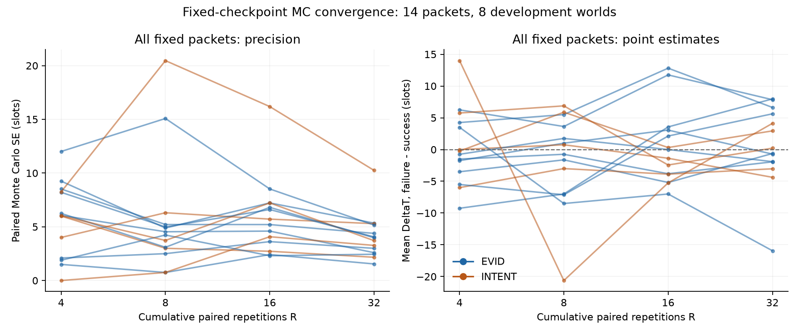

# Research Task Report

- **Research Question / Hypothesis**：[HYPOTHESIS] 固定已有14个packet/state，MC重复由4增至32能否稳定条件任务效应的符号与排序？[RUN] 批次完成，精度中位数改善，但标签仍不稳定；尚未发现足以确证的稳定、可修复且有代表性的性能缺陷。
- **已核验前人工作**：[PAPER] 沿用[定向证据卡](../2026-10-16-mechanism/prior_art.md)：GOSC PDF p3 Eq1、p5 Eq4/Algorithm1、p9 §V-D；BANDMAS p3–4。原作者已有消息反事实和估值保真度诊断，不能将本轮重复扩张称为新方法贡献。本轮未重新阅读PDF、全网查新或核验出版状态。
- **实际阅读源码**：[CODE] 原始核心387b49389385b51c275dc5a22ec1672087edda1d；旧pilot运行48404fd5e68c2f7671845ed10ccd2868423edfbe，归档9196a61effa745d97d0091585b7b5cd8cf11b4a8；本轮实际执行冻结commit **83338a3fa38d049f924c23bde788936990433afa**。复核旧branch、counterfactual状态/随机流/解码干预、原生plan→UL→fusion/DL→motion→next sense/plan顺序；新源码锚点见[evidence_index.md](evidence_index.md)。realistic平行路径未接入本实验。
- **本轮新增或修改**：新增[runner](../../../experiments_ext/run_receiver_cf_precision.py)、[分析器](../../../experiments_ext/analyze_receiver_cf_precision.py)、[9项契约](../../../tests_ext/test_receiver_cf_precision.py)、[仅后处理独立审计](../../../experiments_ext/audit_receiver_cf_precision.py)，以及本目录协议/环境/失败记录/manifest/统计CSV/全点图/报告与任务日志。核心、原results/cache、旧报告、Obsidian保持。原始checkpoint/branch/轨迹仅保留于忽略的本地目录。
- **实际运行**：[RUN] `.venv` Python3.12.10，16项实际依赖匹配lock；Planner、orthogonal UL W100/agent/slot、原生outage/ideal DL、max400。复用seeds5000–5007、t8/24的原14点及packet，新增rep4–31，2workers各1数值线程。执行前完整测试、runner、analyzer、independent audit均实际完成，入口与证据见[command_ledger.json](command_ledger.json)。未新增world、模型、在线策略或LLM实验。
- **测试与结果**：[RUN] 最终执行前完整 **135 passed /65.81s**，内含9项新契约；单独9项0.26s，不能与135相加。新 **784 branches** 全部完成，无运行异常/超时；合并旧112后896 branches、448个配对MC重复、14个packet、**8个独立mission clusters**。R4旧统计精确重建。R32整体DeltaT **+0.638671875 slots，探索性95%cluster CI [−2.54326171875,3.09375]**。独立审计复核56个point×R均值/MCSE与12组mean/CI，结果通过。
- **失败/负面证据**：执行前出现Windows索引斜杠KeyError与GBK读取UTF8审批JSON失败，均在任何新增continuation前修复；详见[implementation_repairs.json](implementation_repairs.json)、[failed-launch.log](failed-launch.log)。测试未失败。新分支false declarations合计15，连旧结果18，全部保留；均为分支运行事件数，不是独立world数。R32仍有6/14非零点MCSE≥|mean|，4点正负翻转，另1点零→负；不能把R32当gold标签。原strict R4失败、R4-S1 statistically_inconclusive和Receiver-D1区间跨零继续保留。
- **与原 GOSC 的差异**：这是固定原生已选packet、同当前发送成本的成功/失败解码离线干预，复用不变的v1实现。保留decoder原draw、ACK/队列/融合和后续规划；不同于免费完整buffer即时交付的代理诊断。没有新online policy；未来总资源成本不匹配，不是公平策略frontier或部署增益。
- **公平性与泄露检查**：旧94项indexed artifacts、76项原始保护文件及冻结运行源码SHA均匹配；所有点/packet/state/config/tape/单原生时隙回放预检通过。按预定范围保留两处无可采packet时隙，不补样、不按outcome选点、不改种子。sender/shared特征与离线oracle标签隔离；8个world已曝光，只作开发诊断，不可用于未见最终评估。未训练/调参，未上传原始数据/PDF或推送远端。
- **成本**：[RUN] 新仿真wall **413.064850s（6分53秒）**，低于900s上限；worker CPU合计 **743.265625s**。单worker lifetime peak RSS最高40,800,256 bytes，parent53,047,296 bytes；不能相加称同时峰值。完整测试另65.81s，初版完整测试56.74s，分析/归档另计且未统一计时。仿真LLM/API calls/tokens=0，无GPU/安装/模型下载；助手tokens未计量。原生UL/DL uses逐分支保留，真实wire bytes、额外ACK/CRC/PHY/sync仍not_modeled。
- **可否进入下一阶段**：**Go：固定checkpoint精度审查与证据归档完成；Pending：可靠标签、机制归因与代表性；No-Go：稳定缺陷、新估值器优势、论文创新成立或部署收益主张。** MC的R=4/32与原论文复现关卡R4是不同概念，不能用本轮通过改判原严格复现失败。
- **用户需要批准的下一步**：建议先审定[现有轨迹机制审查方案](next_stage_plan.md)，解释实际receiver目标改变、任务效应及成本之间的断点，再决定是否值得新实验。该方案尚未执行；不自动扩大R/world、不训练估值器。本轮结束后停止。

## 估计量、样本与区间边界

[CODE/RUN] DeltaT=T_failure−T_success，正值表示该固定尝试成功解码后更早完成。每点先平均R个配对差，mission内再平均点，最后mission等权；EVID和INTENT只汇总有相应点的mission。因此整体不是按消息数加权的两类均值。点级MCSE=sd(配对差,ddof=1)/sqrt(R)，衡量固定状态下有限随机流样本的精度，不是跨mission的泛化区间。

[RUN] 全批采用预定累计R=4/8/16/32；层级重叠，不是4次独立复制。mission-cluster bootstrap 4000次、seed0保留重复抽样的重数；仅8个开发world，区间为探索性，未另传播有限MC误差，未作确认性多重比较检验。INTENT只有5个world，空类型抽样2次如实保留为无效。无效rho与有效次数全部见JSON。原2个无原生已选E/I时隙5002:t24、5007:t24保持空缺。

## 全部预定累计层级（由statistics_by_R.json生成）

[RUN] 均值单位slots；方括号为探索性95%mission-cluster区间。

|R|整体 / 8 missions|EVID / 9点、7 missions|INTENT / 5点、5 missions|
|---:|---|---|---|
|4|+1.0938 [-2.5000, 5.2656]|-1.0179 [-4.7321, 2.7035]|+2.7000 [-3.0833, 9.2917]|
|8|-2.6797 [-8.3443, 1.6250]|-1.2232 [-4.5625, 2.2500]|-2.0250 [-11.8266, 5.8750]|
|16|+0.1562 [-2.7148, 3.0471]|+3.6161 [-0.7033, 8.4732]|-2.5250 [-4.3125, -0.6042]|
|32|+0.6387 [-2.5433, 3.0938]|+2.4487 [-2.1228, 6.4949]|-0.0250 [-3.0312, 3.0781]|

整体/EVID每层4000/4000有效bootstrap，INTENT每层3998/4000；具体无效数不删除。

|R|点级MCSE中位数|最大MCSE|MCSE≥abs(mean) / 非零点|点均值正/零/负|
|---:|---:|---:|---|---|
|4|6.0475|12.0104|12/13|5/1/8|
|8|4.3883|20.4659|5/14|7/0/7|
|16|5.4614|16.1896|8/13|6/1/7|
|32|3.8472|10.2498|6/14|7/0/7|

[RUN] R32排序相关的点估计/区间；null表示常量或不可定义，不能填0。

|类型|分值|Spearman rho|探索性95%区间|有效bootstrap / 4000|
|---|---|---:|---|---:|
|EVID|tom|-0.0333|[-0.9259, 1.0000]|4000/4000|
|EVID|tv|-0.3667|[-0.8920, 0.4713]|4000/4000|
|EVID|bits|-0.2762|[-1.0000, 0.7062]|4000/4000|
|EVID|aoi|-0.2623|[-0.8660, 0.5574]|3997/4000|
|INTENT|tom|-0.2000|[-1.0000, 1.0000]|3833/4000|
|INTENT|tv|undefined|undefined|0/4000|
|INTENT|bits|undefined|undefined|0/4000|
|INTENT|aoi|0.3536|[-0.4472, 1.0000]|2564/4000|

## 结果意味着什么

[RUN] R32点标签为7正/0零/7负。相比R4，8点MCSE下降、6点反而上升；中位数6.048→3.847，最大值仍10.250 slots。只有5/14点在4个累计层级始终同非零符号；这也不是独立重复的稳定性证明。最大绝对均值漂移19.4375 slots。全部14点和56个单元均保留于[point_summary.md](point_summary.md)、[per_point_by_R.csv](per_point_by_R.csv)、[convergence.csv](convergence.csv)。

[RUN] R16的INTENT均值区间[−4.3125,−0.6041667]曾不含零，但R32变为[−3.03125,3.078125]。所有预定层级一并报告，不能截取中间层级宣称确认性伤害效应。

[RUN] R4 ToM rho为EVID +0.4833、INTENT +0.4；R32为−0.0333、−0.2且区间很宽。这说明本批少量点的相关估计对MC精度敏感，不能证明ToM没有排序能力或存在普遍缺陷。样本仅含原生调度已选packet，具有选择范围限制；未比较所有候选、任何新策略或独立最终测试集。

[RUN] R32实际下一次receiver目标改变数的全点均值为0.44643；即时shadow重规划为0.35714，后者不是真实执行动作。任务完成不是目标改变的必然结果。R32 mission等权的成功−失败总记录UL+DL uses均差−214.552734375，仅为描述性结果，无成本区间或cost-matched策略比较；不能称为净效率提升。任务质量、false declaration、UL bits/symbols、DL symbols、delivered bits及每点配对正零负数全部保留于CSV/raw，未只保留completion time。

[HYPOTHESIS] 困难可能来自任务结果对后续随机轨迹敏感、目标迟滞/时序的代理偏差，或部分消息确实有条件的负作用。本轮没有拆分识别这些机制。5005:t24的EVID由R4 +3.5变为R32 −15.9375±5.1595（1MCSE）可用于事后个案核查，但选它作为例子不能证明代表性或迟滞因果效应。

## 环境、保护与重建

[RUN] i7-11700F（8C/16T），物理内存16,962,883,584 bytes；Windows11家庭中文版10.0.26200/x64；见[hardware_current.json](hardware_current.json)。不可变起始manifest保留其原环境索引，当前硬件核验作为独立附件，没有回写起始manifest。Python/lock/实际16项依赖、source/config/checkpoint/tape hashes见[experiment_manifest.json](experiment_manifest.json)。

[RUN] 原112条在 `E:\gosc-agentic-teams\.local\reproduction\2026-10-16-cf-pilot-v1`；新784条及轨迹在 `E:\gosc-agentic-teams\.local\reproduction\2026-10-18-cf-precision-v1\point-*\branches.jsonl`。新raw索引见[raw_artifact_index.json](raw_artifact_index.json)，只有hash索引不能替代raw数据。重建指令与源码行锚见[evidence_index.md](evidence_index.md)。完整性与独立数值审计见[independent_audit.json](independent_audit.json)、[preanalysis_audit.json](preanalysis_audit.json)。

[CODE/RUN] 执行前测试覆盖冻结runner/analyzer/loader；独立审计脚本在数据生成后新增并实际执行，其检查结果不冒称已包含在135项执行前测试中。两个运行前修复与全部初版通过/失败记录均保留。新仿真冻结于83338a3，报告归档commit另见本地Git历史和忽略raw目录的closure.json；无推送。
